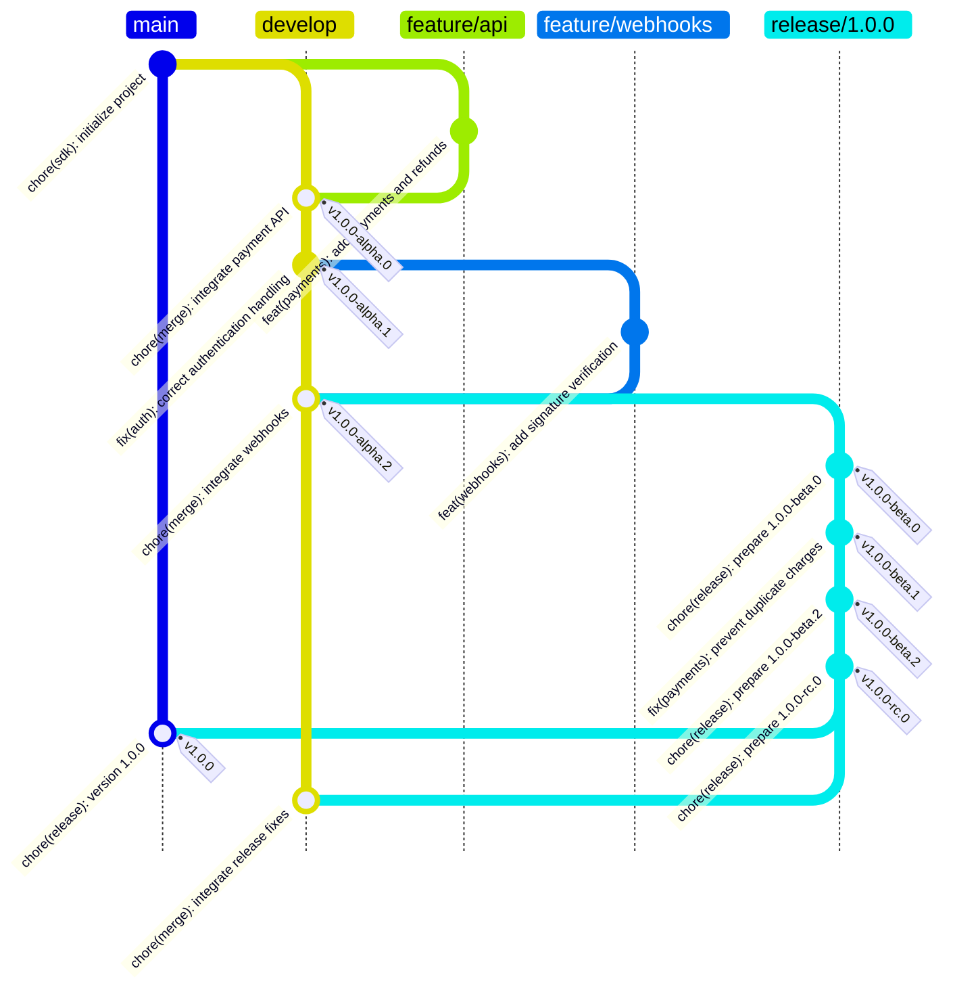

# Versioning Guidance

Versioning guidance defines how software release identifiers are selected, validated, and published.

> [!NOTE]
> Versioning guidance specifies version syntax and precedence. Commit-message conventions and branching strategies are separate project decisions.

- [1. Category](#1-category)
  - [1.1. Semantic Versioning (SemVer)](#11-semantic-versioning-semver)
    - [1.1.1. Stable Release](#111-stable-release)
    - [1.1.2. Pre-release](#112-pre-release)
    - [1.1.3. Build Metadata](#113-build-metadata)
- [2. Best Practice](#2-best-practice)
  - [2.1. Branching Workflow](#21-branching-workflow)
- [3. References](#3-references)

## 1. Category

### 1.1. Semantic Versioning (SemVer)

The [Semantic Versioning (SemVer)](https://semver.org/spec/v2.0.0.html) specification defines three required numeric components with optional pre-release identifiers and build metadata.

Stable releases, pre-releases, and build metadata have distinct roles within that scheme.

```plaintext
MAJOR.MINOR.PATCH[-PRERELEASE][+BUILD]
```

> [!NOTE]
> The bracketed portions in the representation are optional. The required numeric components are non-negative integers without leading zeroes.

#### 1.1.1. Stable Release

A stable release has no pre-release suffix. Once a public API reaches version `1.0.0`, changes to that API determine which numeric component increases.

1. Concepts and Components

    | Component | Description | Example |
    | --- | --- | --- |
    | `MAJOR` | Increments for backward-incompatible API changes. The minor and patch components reset to zero. | `1.4.2` → `2.0.0` |
    | `MINOR` | Increments for backward-compatible functionality added to the public API. The patch component resets to zero. | `1.4.2` → `1.5.0` |
    | `PATCH` | Increments for backward-compatible bug fixes. | `1.4.2` → `1.4.3` |

2. Examples and Explanations

    The sequence illustrates successive stable releases and their SemVer precedence:

    ```plaintext
    1.4.2 < 1.4.3 < 1.5.0 < 2.0.0
    ```

    A release containing both a backward-compatible feature and a bug fix advances `1.4.2` to `1.5.0`.

3. Rules

    1. Public API Contract

        Define the public API before assigning compatibility meaning to version numbers. API contracts may be expressed in code, documentation, or both.

    2. Change Impact

        For versions `1.0.0` and later, select the increment required by the included changes: major for backward-incompatible public API changes; otherwise minor for backward-compatible public API additions or deprecations; otherwise patch for backward-compatible bug fixes.

    3. Release Immutability

        Treat published release contents as immutable. A correction requires a new version rather than replacement of a published artifact.

    4. Initial Development Policy

        During initial development (`0.y.z`), the public API is not considered stable. Document the project's policy for version increments and compatibility during this phase.

#### 1.1.2. Pre-release

A pre-release appends a hyphen and dot-separated identifiers to a target version, such as `1.1.0-beta.1`. Every pre-release has lower precedence than the corresponding stable version.

> [!NOTE]
> SemVer defines identifier syntax and ordering, but does not prescribe testing stages or release-readiness criteria.

1. Concepts and Components

    | Identifier | Description | Example |
    | --- | --- | --- |
    | Alpha (`alpha`) | A project-defined label commonly used for early integration and exploratory testing. | `1.1.0-alpha.0` → `1.1.0-alpha.1` |
    | Beta (`beta`) | A project-defined label commonly used for broader compatibility and acceptance testing. | `1.1.0-beta.0` → `1.1.0-beta.1` |
    | Release Candidate (`rc`) | A project-defined label commonly used for builds undergoing final release qualification. | `1.1.0-rc.0` → `1.1.0-rc.1` |

2. Examples and Explanations

    The sequence illustrates SemVer precedence for the same target stable version:

    ```plaintext
    1.1.0-alpha.0 < 1.1.0-alpha.1 < 1.1.0-beta.0 < 1.1.0-rc.0 < 1.1.0
    ```

3. Rules

    1. Identifier Syntax

        Separate pre-release identifiers with periods. Each identifier must be nonempty and contain only ASCII letters, digits, or hyphens; purely numeric identifiers must not contain leading zeroes.

    2. Identifier Precedence

        For pre-release versions with identical major, minor, and patch components, compare identifiers from left to right until a difference is found. Compare numeric identifiers numerically and non-numeric identifiers in ASCII lexical order; numeric identifiers have lower precedence than non-numeric identifiers. If all shared identifiers match, the version with additional identifiers has higher precedence.

    3. Stage Numbering

        Document the project's pre-release labels, starting counters, and counter-increment policy. Labels such as `alpha`, `beta`, and `rc`, and starting counters at `.0`, are project conventions.

    4. Stable Release Qualification

        Publish a stable version without the pre-release suffix only after completing the project's release gates.

#### 1.1.3. Build Metadata

Build metadata records build provenance using project-defined labels such as `build` and `sha`. The [Versioning article](../articles/versioning.md#11-semantic-versioning-semver) defines its syntax.

1. Concepts and Components

    | Metadata | Description | Example |
    | --- | --- | --- |
    | Build Number (`build`) | A build number used to distinguish builds. | `1.1.0+build.27` |
    | Source Revision (`sha`) | A source revision identifier used to trace a build to its source commit. | `1.1.0-rc.1+sha.a2e62b` |

2. Examples and Explanations

    Build metadata does not affect SemVer precedence:

    ```plaintext
    1.1.0+build.27 = 1.1.0+build.28
    1.1.0-rc.1+sha.a2e62b = 1.1.0-rc.1
    ```

    The `=` symbol denotes equal precedence, not identical version strings or artifact contents.

    Build metadata does not promote a pre-release to a stable release: `1.1.0-rc.1+build.28` still has lower precedence than `1.1.0+build.27`.

3. Rules

    1. Artifact Traceability

        Record the source revision associated with each published artifact. When build metadata contains a source identifier, ensure that it resolves to that revision.

## 2. Best Practice

### 2.1. Branching Workflow

A branching workflow coordinates change integration, release stabilization, qualification, and publication.

> [!NOTE]
> The worked example applies [Git Flow](../articles/branching-strategies.md#12-git-flow) to the first stable release of a software development kit (SDK). Feature integration occurs on `develop`, release stabilization on `release/1.0.0`, and stable publication on `main`.
>
> Commit labels in the diagram follow [Conventional Commits](../articles/commit.md#11-conventional-commits). The `v` prefix on Git tags is a repository convention, not part of the SemVer version string.



## 3. References

- Sentenz [Versioning](../articles/versioning.md) article.
- Sentenz [Commit](../articles/commit.md) article.
- Sentenz [Changelog](../articles/changelog.md) article.
- Sentenz [Branching Strategies](../articles/branching-strategies.md) article.
- Semantic Versioning [Semantic Versioning 2.0.0](https://semver.org/spec/v2.0.0.html) specification.
- Conventional Commits [Conventional Commits 1.0.0](https://www.conventionalcommits.org/en/v1.0.0/) specification.
- Mermaid [GitGraph Diagrams](https://mermaid.js.org/syntax/gitgraph.html) documentation.
